# Windows

## WSL インストール
- ターミナルを管理者として起動
```powershell
$ wsl --install
```
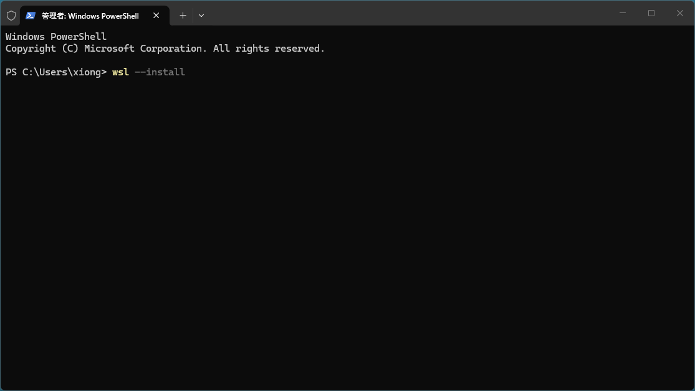

## 再起動

## WSL Ubuntu インストール
- ストアで Ubuntu をインストール

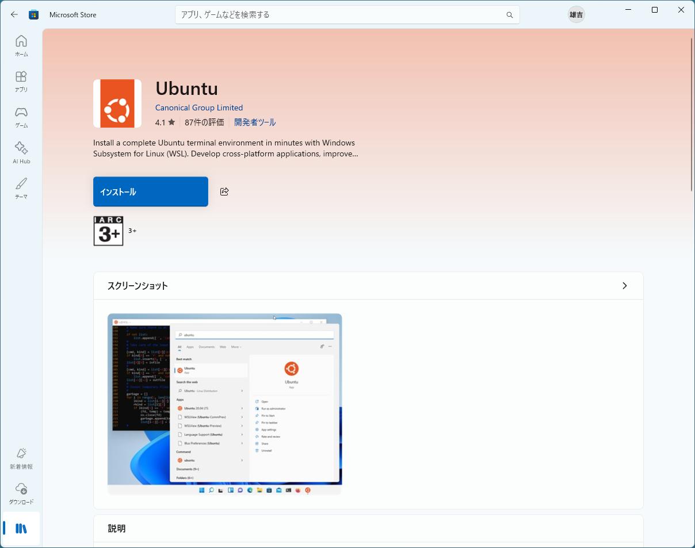

## VSCode インストール
- VSCode をインストール
    - 実行できればどの方法でもいい
        1. Microsoft Store 経由
        1. VSCode ダウンロードページの zip を解凍
- Remote Development プラグインをインストール
    - remote development でプラグインを検索

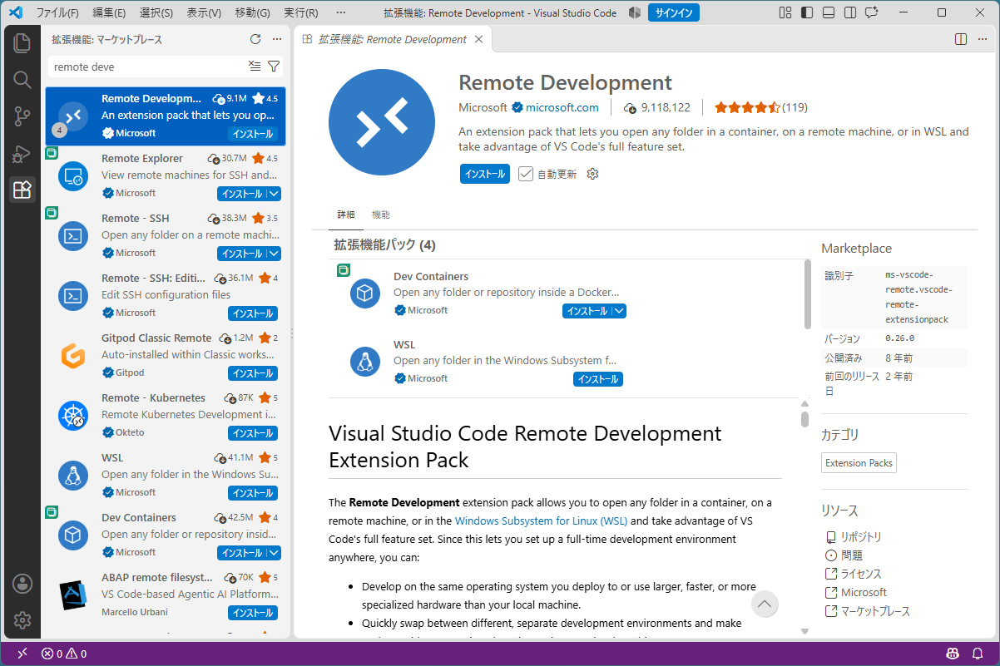

## WSL Ubuntu 起動
- 以下どちらでもいい
    - ターミナル > コマンド「WSL」
    - スタートメニュー > Ubuntu
```powershell
$ wsl
```
- 初回起動時は Ubuntu にログインするユーザー名とパスワードの設定を求められる

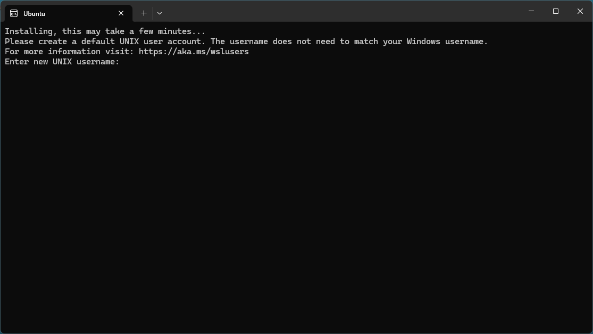


# WSL

## 開発コンテナ用リポジトリの用意
- エクスプローラーでディレクトリごと WSL 仮想マシン内にコピーする

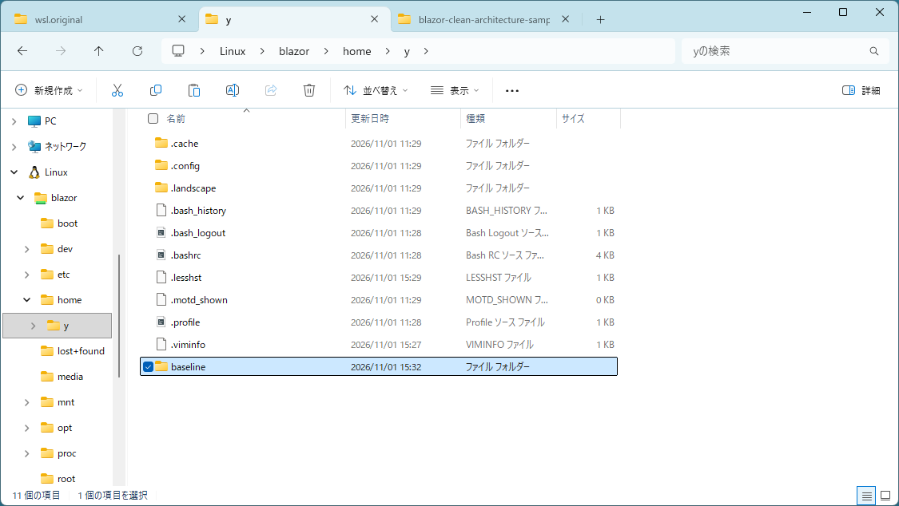

- devcontainer.json 内に記載されているネットワーク名を修正
    - bom-net から名前を変更する場合

## Docker インストール
```bash
$ sudo apt update
$ sudo apt install ca-certificates curl
$ sudo install -m 0755 -d /etc/apt/keyrings
$ sudo curl -fsSL https://download.docker.com/linux/ubuntu/gpg -o /etc/apt/keyrings/docker.asc
$ sudo chmod a+r /etc/apt/keyrings/docker.asc
$ sudo tee /etc/apt/sources.list.d/docker.sources <<EOF
Types: deb
URIs: https://download.docker.com/linux/ubuntu
Suites: $(. /etc/os-release && echo "${UBUNTU_CODENAME:-$VERSION_CODENAME}")
Components: stable
Architectures: $(dpkg --print-architecture)
Signed-By: /etc/apt/keyrings/docker.asc
EOF
$ sudo apt update
$ sudo apt install docker-ce docker-ce-cli containerd.io docker-buildx-plugin docker-compose-plugin
```

### ユーザーを docker グループへ追加
```bash
$ sudo usermod -aG docker <ユーザー>
```
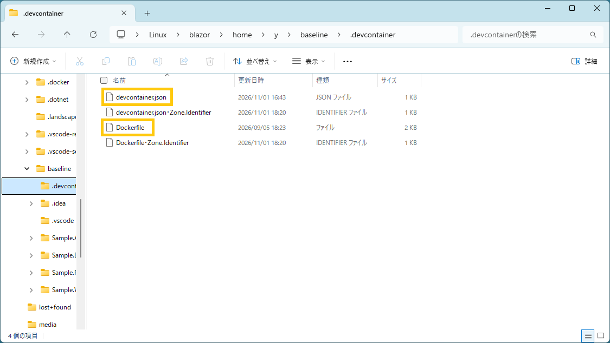
- 毎回「sudo」docker & パスワードの入力をせずに済むようにする設定
    - **注意 : この設定は開発環境専用** 本番環境でこの設定をしてはならない
- 一度ターミナルを閉じて開きなおす

## ORACLE イメージの pull
```bash
$ docker pull container-registry.oracle.com/database/free:latest
```

## Docker ネットワーク bom-net 作成
- ORACLE コンテナ ⇔ Debian 13 ( .net ) コンテナ間の通信をコンテナ名で解決できるようにする設定
```bash
# ネットワーク名は任意, この例ではサンプルアプリの名前が部品構成表登録画面なので bom-net
$ docker network create bom-net
```

## ORACLE コンテナ作成・起動
```bash
$ docker run -d --name oracle -p 1521:1521 --network bom-net -e ORACLE_PWD=<SYS, SYSTEM, PDBADMIN パスワード> container-registry.oracle.com/database/free:latest
# docker ps で oracle のステータスが healthy になるまで待つ
$ docker exec -it oracle sqlplus 'sys/<SYS パスワード>@localhost:1521/FREE' as sysdba
# 接続先プラがブルデータベースの指定
sql> ALTER SESSION SET CONTAINER = FREEPDB1;
# ユーザー作成
sql> CREATE USER DEV_USER IDENTIFIED BY "<DEV_USER パスワード>";
# 表領域の割り当て制限を無制限に設定
sql> ALTER USER DEV_USER DEFAULT TABLESPACE users QUOTA UNLIMITED ON users;
# DEV_USER の権限設定
sql> GRANT CONNECT, RESOURCE TO DEV_USER;
sql> GRANT CREATE TABLE, CREATE VIEW, CREATE SEQUENCE, CREATE PROCEDURE TO DEV_USER;
sql> quit
```

## ORACLE 内にテストデータテーブル作成
- Sample.Persistence/create_tables.sql を DEV_USER で実行
```bash
$ docker exec -i -e NLS_LANG=AMERICAN_AMERICA.AL32UTF8 oracle \
  sqlplus -S 'DEV_USER/<DEV_USER パスワード>@localhost:1521/FREEPDB1' \
  < baseline/Sample.Persistence/create_tables.sql
```

# 開発コンテナ

## WSL Ubuntu を VSCode で開く
- Remote 拡張機能で接続
1. VSCode ウィンドウ左下「⇔」ボタンをクリック
1. 「ディストリビューションを使用して WSL に接続」

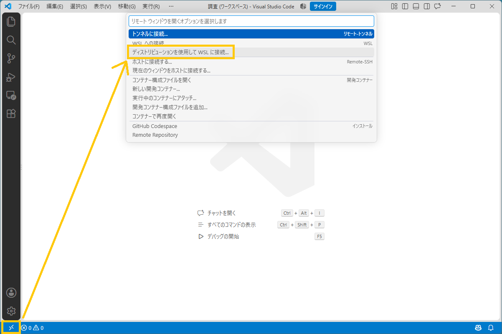

1. .net 開発環境 Docker コンテナをこれから作成するディストリビューション名を指定
    - この例ではディストリビューション Ubuntu のコピー「blazor」を作成しており、blazor の中に開発環境を用意する

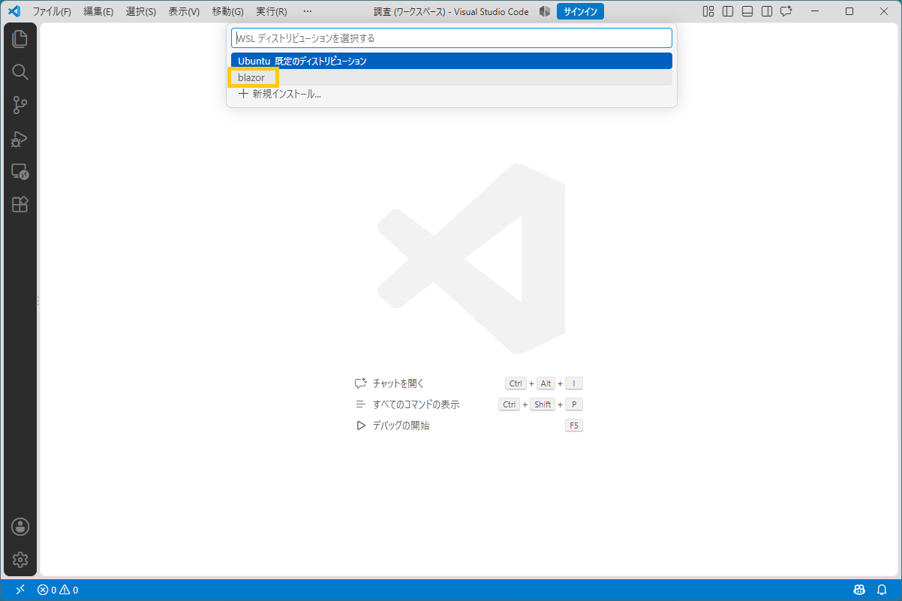

## リポジトリのコピー先ディレクトリを VSCode で開く
1. 「フォルダーを開く」
1. 親ディレクトリの指定, 例では /home/y/
1. 開くディレクトリ : リポジトリのコピー先ディレクトリを指定, 例では baseline

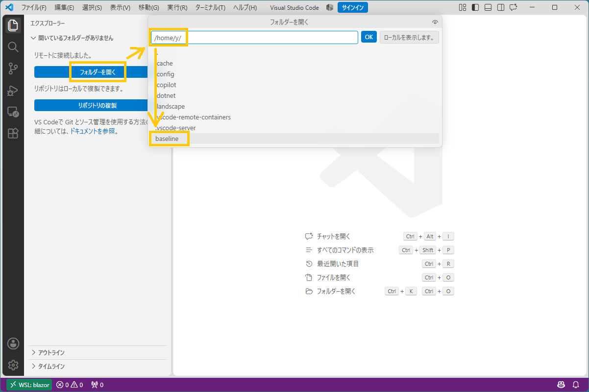

## コンテナで再度開く
- 方法 1 : 右下ポップアップウィンドウの「コンテナで再度開く」をクリック

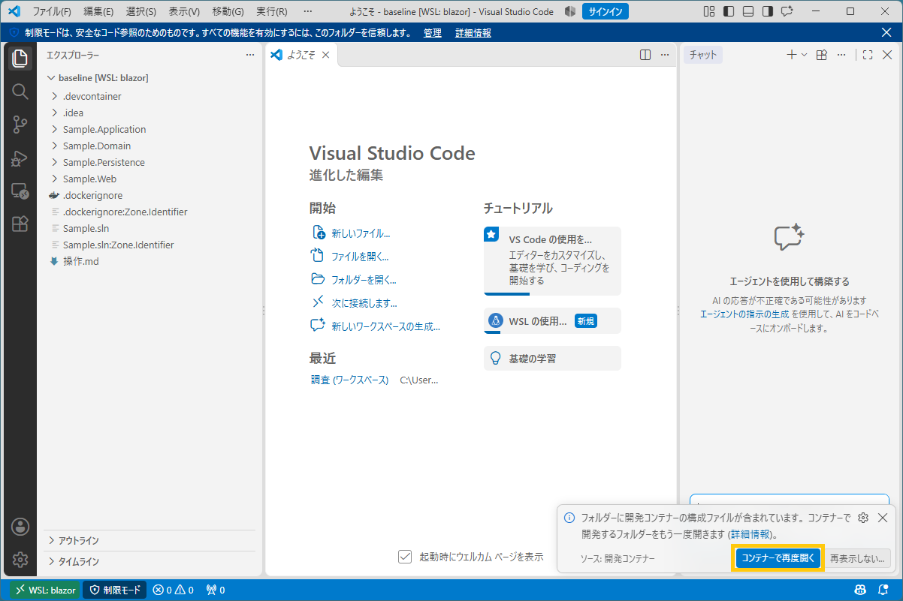

- 方法 2 : Shift + Ctrl + P でコマンドパレットを開き、「開発コンテナで再度開く」

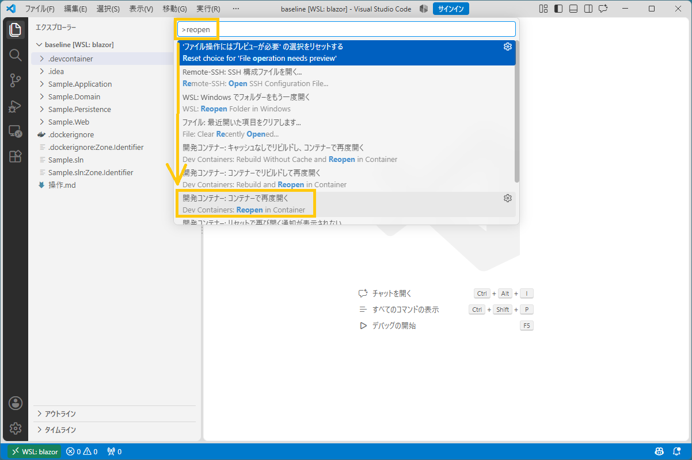

## ビルド・実行
```bash
$ dotnet build Sample.sln
$ dotnet run --project Sample.Web/Sample.Web.csproj
```
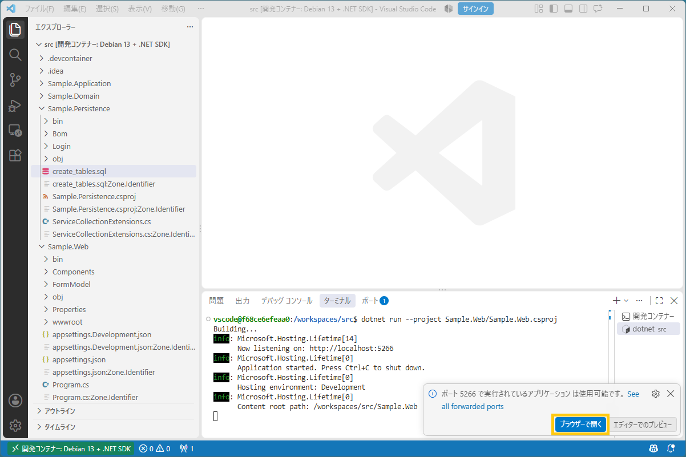
- リポジトリ blazor-clean-architecture-sample の構成では上の通り
    - コピーしたリポジトリの内容により異なる

## ASP.net アプリケーションのデバッグ
- デバッグ実行用のファイルを作成

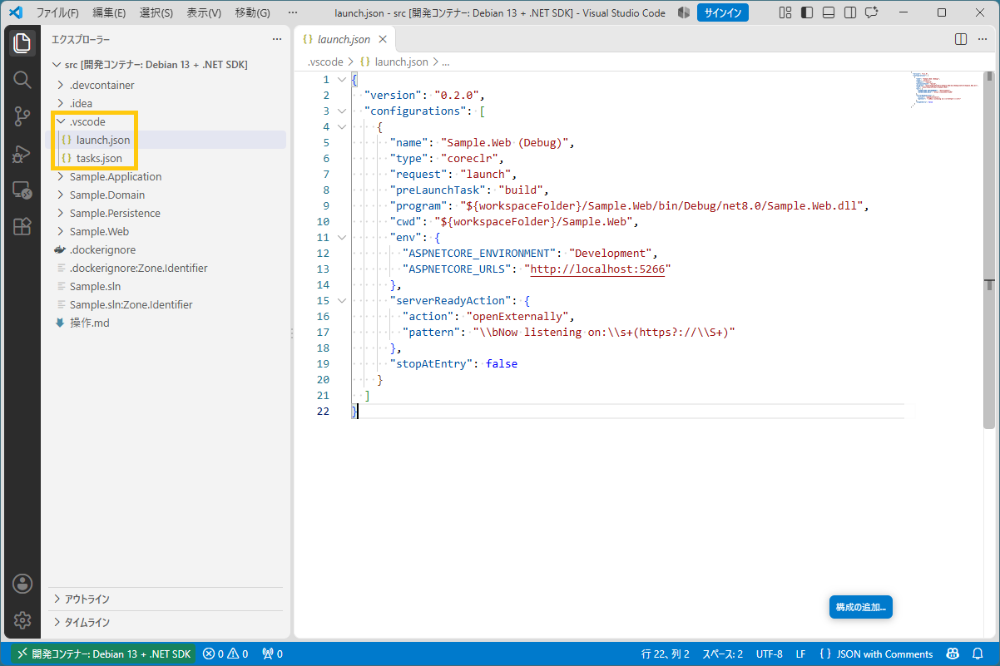

- .vscode/launch.json
- [launch.json の例はこちら](https://github.com/YuhichYOC/blazor-clean-architecture-sample/blob/main/%E9%96%8B%E7%99%BA%E7%92%B0%E5%A2%83%E6%BA%96%E5%82%99/WSL/%E3%83%87%E3%83%90%E3%83%83%E3%82%B0%E5%AE%9F%E8%A1%8C%E7%94%A8%E8%A8%AD%E5%AE%9A%E3%83%95%E3%82%A1%E3%82%A4%E3%83%AB/launch.json)
    - 13 行目 : ASP.net 待ち受けポートは baseline/Sample.Web/Properties/launchSettings.json で指定した待ち受けポートと合わせる
- .vscode/tasks.json
    - launch.json 用のビルドタスクを定義
- [tasks.json の例はこちら](https://github.com/YuhichYOC/blazor-clean-architecture-sample/blob/main/%E9%96%8B%E7%99%BA%E7%92%B0%E5%A2%83%E6%BA%96%E5%82%99/WSL/%E3%83%87%E3%83%90%E3%83%83%E3%82%B0%E5%AE%9F%E8%A1%8C%E7%94%A8%E8%A8%AD%E5%AE%9A%E3%83%95%E3%82%A1%E3%82%A4%E3%83%AB/tasks.json)
- ▷ ボタンをクリックすることでデバッグ実行開始

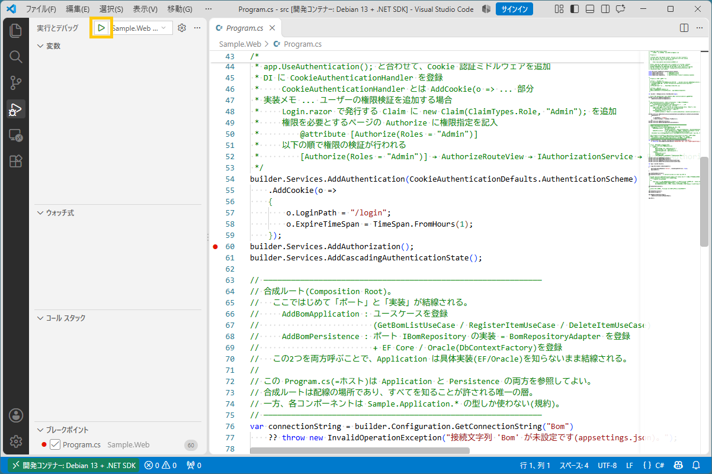

- ブレークポイントで実行停止し、変数の内容を見ることができる

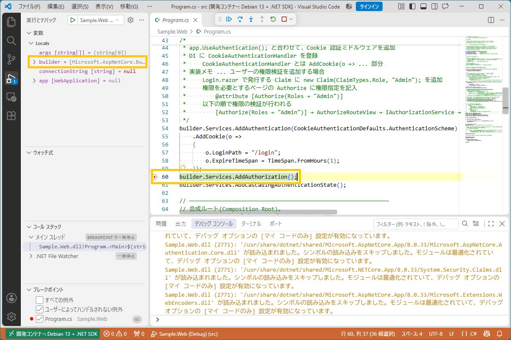

## Claude Code のインストール
- 開発コンテナ内で実行する
    - 実行するディレクトリはどこでもいい
- インストール後は一度ターミナルを閉じて開きなおす
    - 環境変数の反映が済ませるため
```bash
$ curl -fsSL https://claude.ai/install.sh | bash
```
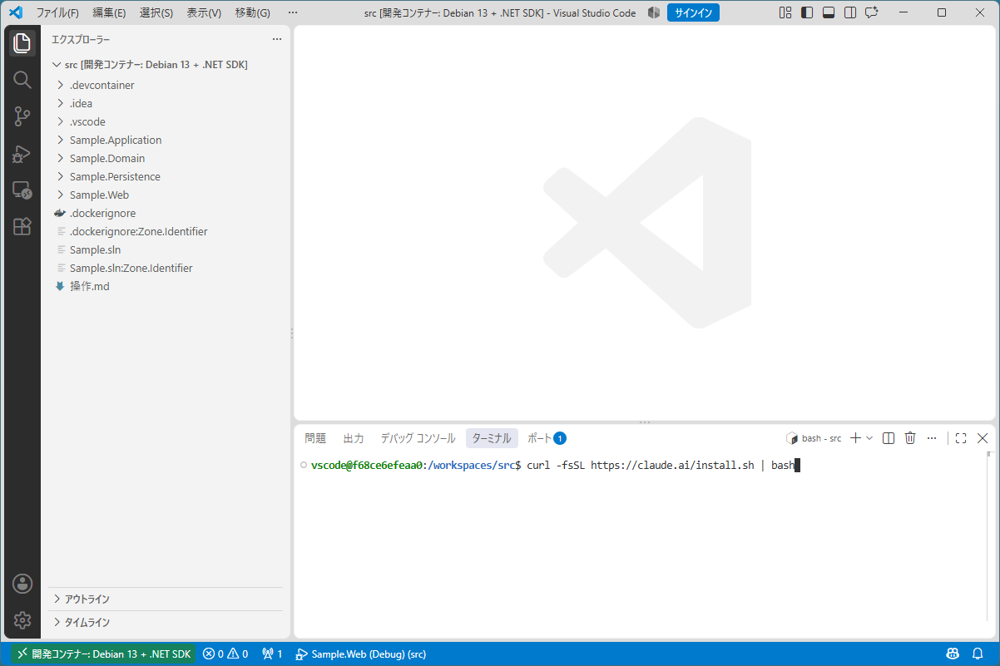

### Claude Code 起動
- リポジトリのコピー先で実行する
```bash
$ claude
```
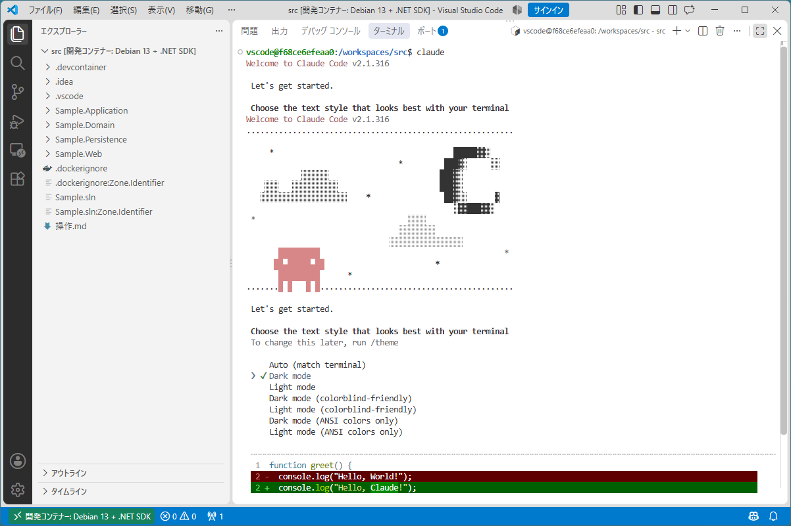
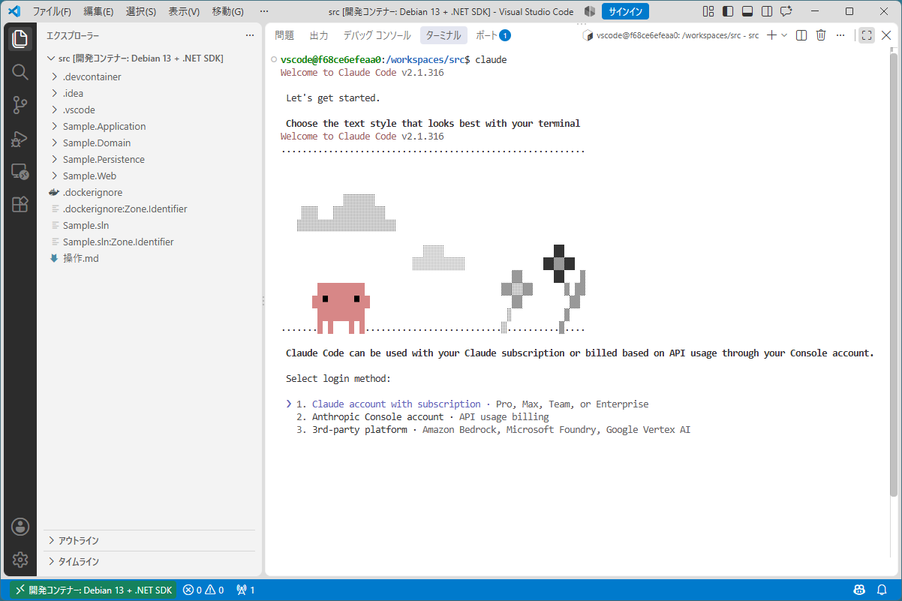
